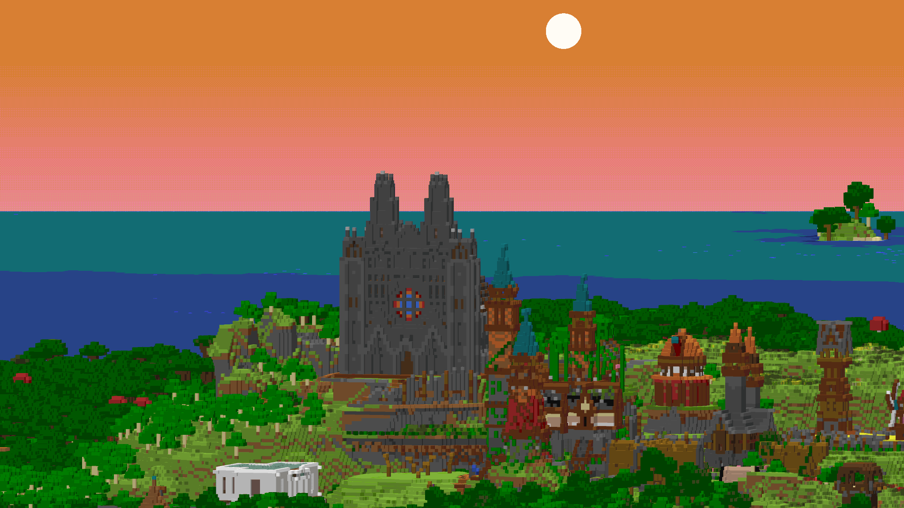

# Izomap

Isometric photography for Minecraft servers. Put a camera in your world, aim it with a live
preview, and take a photo of what it sees: Izomap casts a ray for every pixel and prints the picture
onto maps that hang on any wall, from a single map to a 16x9 mural. Every player sees them, and no
resource pack is needed.



**Website and documentation:** <https://zypec.github.io/izomap/>

## Features

- A live preview map in your off hand while you turn, tilt, zoom and move the camera
- Orthographic (isometric) projection, from top-down town views to low horizon shots
- Sun shadows, ambient occlusion, block light, biome-tinted grass and water shaded by depth
- Skies with the sun, the moon in its phase and stars; depth of field; color filters
- Photos survive restarts and never change until retaken; decoration frames
- Permissions decide how large and how expensive a photo may be, per group

## Requirements

Paper 26.3 or newer, Java 25.

## Building

```bash
./gradlew build          # build/libs/izomap-<version>.jar
./gradlew runServer      # a Paper 26.3 development server in run/
```

The site and the wiki are generated with `./gradlew generateWiki`, which needs the shared kit from
[zypec/zypec.github.io](https://github.com/zypec/zypec.github.io) checked out beside this
repository. How the plugin is built inside is in [docs/ARCHITECTURE.md](docs/ARCHITECTURE.md).
