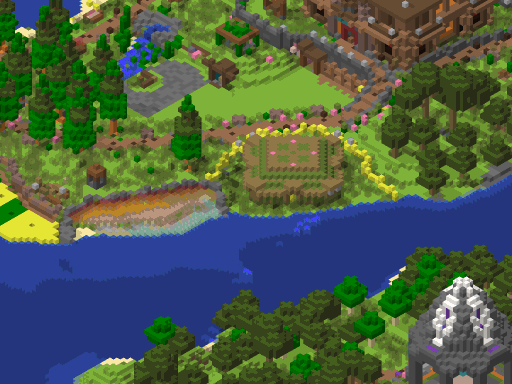

# Filters

A filter is a chain of operations a color goes through before it is matched to the map palette. Players pick one on the capture screen. `filters.yml` holds them, and you can write your own.

### The shipped filters

<figure class="filters"><figcaption>The Original filter. <a href="../#filters">The front page</a> flips the same view through every filter the plugin ships with.</figcaption></figure>

| ID | Operations |
|---|---|
| `ORIGINAL` | none |
| `WARM` | `rgb-offset: {r: 25, g: 8, b: -20}` |
| `COOL` | `rgb-offset: {r: -20, g: 6, b: 25}` |
| `GRAYSCALE` | `grayscale: true` |
| `SEPIA` | `grayscale`, then `tint` towards `#C0955F` |
| `VIVID` | `saturation: 1.35`, `contrast: 1.1` |
| `NOIR` | `grayscale`, `contrast: 1.4` |

### Operations

| Operation | Does |
|---|---|
| `brightness: 1.2` | Multiplies every channel; above 1 brightens |
| `contrast: 1.15` | Pushes away from middle gray; below 1 pulls towards it |
| `saturation: 0.8` | More or less color; 0 is gray |
| `rgb-offset: {r: 25, g: 8, b: -20}` | Adds to each channel |
| `grayscale: true` | Gray by luma; or give your own weights, `{r: 0.299, g: 0.587, b: 0.114}` |
| `tint: {color: "#FFD9A0", strength: 0.25}` | Pulls the color towards another |
| `invert: true` | Inverts |
| `posterize: 6` | Rounds each channel to that many steps |

They run in the order written.

### Writing your own

<pre data-title="filters.yml">filters:
  GOLDEN_HOUR:
    ops:
      - brightness: 1.08
      - tint: {color: "#FFB35C", strength: 0.2}
      - saturation: 1.15</pre>

Then give it a name players see, in `messages.yml`:

<pre data-title="messages.yml">filter:
  GOLDEN_HOUR: "<#FFB35C>Golden hour"</pre>

and a permission to whoever may use it: `izomap.filter.GOLDEN_HOUR` (or `izomap.filter` for all). Run `/izocam reload`.

- The key is the filter's id, and only the id is saved with cameras and photos. Renaming a filter in `messages.yml` changes nothing saved.
- A filter with no name in `messages.yml` shows its id.
- `ORIGINAL` always exists and does nothing, whatever the file says. An unknown id falls back to it.
- An operation the plugin does not know skips itself, not the whole filter, and is logged.

### What a filter costs

Nothing per pixel. A map has only 244 colors, so a filter is worked out once for each of them when a render starts and kept as a table. A long chain is as fast as none.
